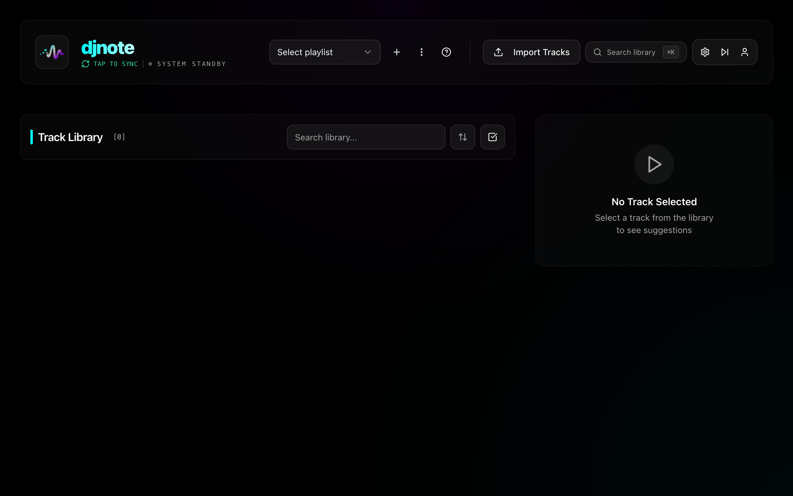
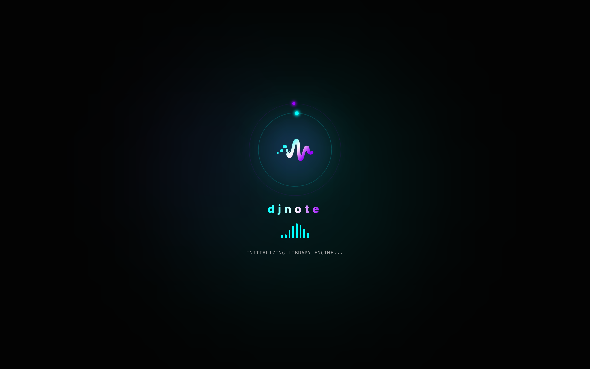

# DJNote

**Never forget a good transition again.**

DJNote is a personal transition notebook for DJs. When you find a mix that works, you save it: Track A goes well into Track B. Over time, DJNote becomes your own map of tested transitions, set ideas, and track relationships based on real practice and real gigs.

When you are playing live and need the next track, DJNote helps you find the tracks you already know work with what is currently playing, instead of relying on memory under pressure.

This public repository contains DJNote documentation, release notes, screenshots, and downloadable builds. The application source code is maintained privately.

## Why DJNote Exists

Every DJ has had the same moment: a track is peaking, the room is ready, and you know you have mixed it perfectly into something before, but you cannot remember what.

You either guess and risk the transition, or play it safe and lose energy.

DJNote is built for that exact moment. It gives you a practical place to store your best transitions and recall them fast when it matters.

## What It Does

- Save proven transitions between tracks
- See compatible next-track ideas from your own saved history
- Use BPM and Camelot/key matching to discover new options
- Build set ideas from saved transitions and harmonic matches
- Review session history and remember what you played
- Keep your DJ notes available across supported devices

## Downloads

Download the latest public builds from the [GitHub Releases page](https://github.com/jakkarudev/DJNote/releases).

Current public desktop build:

- macOS: `DJNote_1.2.1_x64.dmg`
- Windows: `DJNote_1.2.1_x64.exe`

## Screenshots

## Who It Is For

DJNote is for DJs who want a practical memory system for their sets:

- Club DJs tracking what works on real dancefloors
- Mobile DJs preparing reliable transitions for events
- Bedroom DJs building better practice habits
- Open-format DJs managing large libraries
- Anyone who wants their transition knowledge to survive beyond memory

## Privacy And Source Code

This repository is intentionally public and limited to:

- User-facing documentation
- Release notes
- Public screenshots and branding assets
- Downloadable release binaries

Private source code, service configuration, signing material, database internals, and development documentation are not published here.

DJNote includes account, sync, subscription, and optional advertising features depending on platform and plan. Review the in-app Privacy Policy and Terms of Service before using the app.

## Support

For support, bug reports, or release questions, use this repository's Issues tab.
